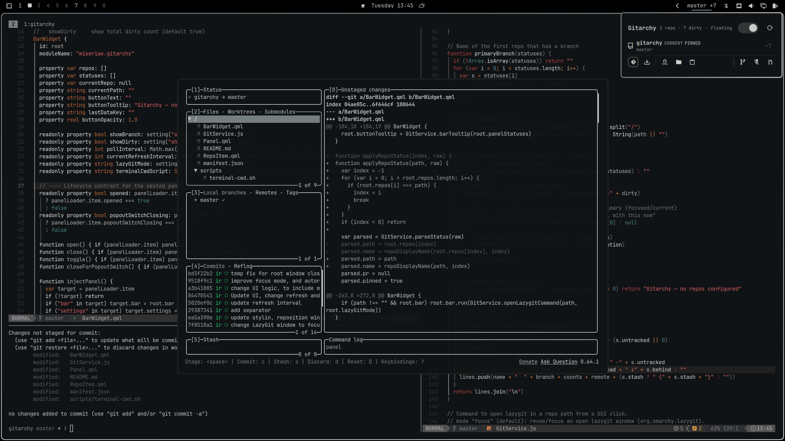

# Gitarchy

Git status for watched repos in the Omarchy bar: dirty counts, branches,
stash, ahead/behind, and one-click access to lazygit.



Requires Omarchy 4.5+ (Quattro, the Quickshell-based shell).

## What you see

- **Bar widget** — the primary branch and the total dirty count across all
  watched repos (`master +3`). Its label is empty when there is nothing to show.
  The widget is hidden in that state. When the focused repo has conflicts or an
  operation in progress it shows a marker
  (`master !2` for conflicts, `master · merge` while merging/rebasing). Left-click
  opens the panel, right-click opens lazygit for the primary repo, middle-click
  refreshes immediately.
- **Panel** — the git repo of the currently focused terminal first (marked
  `CURRENT`, so the repo you are working in appears automatically), then one
  row per watched repo, each with branch, staged/modified/untracked counts,
  conflict count, stash count, and ahead/behind, with action buttons shown
  underneath. Right-click or double-click opens lazygit directly.

Repos are identified by their Git work-tree root, not the terminal's current
path. A terminal inside a subdirectory of a watched repo therefore shows one
row, is marked `CURRENT PINNED`, and is counted once in the bar.

The focused-terminal repo is detected via the bundled `scripts/terminal-cwd.sh`
(which also resolves working-directory changes inside tmux panes, which the
stock Omarchy helper does not currently resolve). `CURRENT` only appears when
the focused terminal is inside a git repository. Use the **pin** button
underneath it to add it to your watched list permanently — it then shows the
**PINNED** badge and an **unpin** button. Pinning from a subdirectory stores the
repository root, so it never adds a second row.

Per-repo actions: open lazygit, `git fetch`, `git pull` (fast-forward only),
`git push` (uses the branch's upstream), copy the remote URL, copy the branch
name, open the remote in the browser, open it in the file manager, and a
click-to-reveal PR status line (via GitHub CLI, when `gh` is installed).
Fetch/pull/push run in the background; failures appear as a short message under
the row instead of disappearing into the shell log. Clicking a PR line opens it
in the browser.

The bar label is tinted for at-a-glance status: red while a repo has conflicts
or an operation is in progress (merge/rebase/…), accent when there is
uncommitted work, and the normal bar color when everything is clean.

## Install

```sh
omarchy plugin add https://github.com/miseriae/gitarchy --enable
```

`--enable` places the widget immediately; a shell restart is not required.
Remove it with:

```sh
omarchy plugin remove miseriae.gitarchy
```

### Development

```sh
omarchy plugin validate .
omarchy-shell shell rescanPlugins
```

The shell hot-reloads plugins under `~/.config/omarchy/plugins/`. A symlinked
checkout can stay cached, especially when its target is outside that directory;
run `omarchy restart shell` after editing if changes do not appear.

## Requirements

- Omarchy 4.5+ with the Quickshell bar
- `bash`, `git`, `jq`, `hyprctl`, `/proc`, and standard coreutils/procps tools
- Optional: `kitty` + `kitten` and `tmux` for terminal/pane cwd resolution; the
  helper falls back to the terminal's shell cwd when they are unavailable
- Optional: `lazygit` for the "Open lazygit" actions
- Optional: `gh` (GitHub CLI) for the PR status line
- Optional: `wl-copy` (wl-clipboard, part of base Omarchy) for the copy actions
- `omarchy-launch-or-focus-tui` and `omarchy-launch-tui` for lazygit
- `omarchy-launch-browser` for remote URLs; `xdg-open` for the folder fallback

The panel uses Nerd Font icons when the Omarchy bar font is Nerd Font-based.
All icon-bearing controls fall back to standard Unicode symbols if a plain
custom font is selected, so the controls remain visible without installing
another font.

The plugin runs inside Omarchy's long-running shell process with the current
user's permissions. It can read terminal process information, execute `git`
commands, launch applications, and update the widget's own entry in
`~/.config/omarchy/shell.json` when you explicitly pin/unpin a repository or
change the lazygit mode. It does not install packages or run a remote build.

## Configure

Watched repos live in the widget's entry in `~/.config/omarchy/shell.json`.
Edit that entry directly to set the watched repo list:

```json
{
  "version": 1,
  "bar": {
    "layout": {
      "right": [
        { "id": "miseriae.gitarchy", "repos": ["~/projects/a", "/srv/projects/b"], "pollInterval": 30 }
      ]
    }
  }
}
```

Use `omarchy bar set` for individual settings. Scalars are written as strings
(the widget accepts `true`/`false` for booleans); pass `--json` for arrays and
objects:

```sh
omarchy bar set miseriae.gitarchy pollInterval 60
omarchy bar set miseriae.gitarchy showDirty false
omarchy bar set miseriae.gitarchy repos '["~/projects/a", {"path": "~/projects/b", "name": "B"}]' --json
omarchy bar get miseriae.gitarchy repos
```

### Settings

| Key | Type | Default | Description |
| --- | --- | --- | --- |
| `repos` | array | `[]` | Repo paths (strings) or `{ "path": ..., "name": ... }` objects. Paths may use `~`. |
| `pollInterval` | int | 30 | Seconds between git status refreshes for watched repos. |
| `currentRefreshInterval` | int | 2 | Seconds between refreshes of the focused terminal's repo (kept short so the bar and CURRENT row stay live while you work). |
| `showBranch` | bool | `true` | Show the primary branch in the bar. |
| `showDirty` | bool | `true` | Show the total dirty count in the bar. |
| `lazyGitMode` | enum | `focus` | `focus`: reuse/focus an open lazygit window. `floating`: always open and focus a new floating terminal. |

A repo entry's `name` overrides the display label; it defaults to the folder
name. Duplicate paths are ignored, and watched subdirectories of the same repo
collapse into its root row.

## Usage

- **Click** the bar widget to open the status panel
- **Hover** the bar widget for a per-repo tooltip
- **Use** the action buttons shown underneath each repo row
- **Right-click or double-click** a repo row to open lazygit
- **Right-click** the bar widget to open lazygit for the primary repo
- **Middle-click** the bar widget to refresh now
- **j/k** (or arrow keys) to move between repo rows, **Enter** to open lazygit for the selected row, **r** to refresh the panel
- **f** fetch, **p** pull, **P** push, **g** open remote, **c** copy remote URL, **b** copy branch, **u** unpin the selected repo
- **Tab** switches to the next panel in the same bar section

The header toggle switches how lazygit is opened — **Focus** (reuse/focus an
open lazygit window) or **Floating** (always open a new floating terminal).
The choice persists and is the same `lazyGitMode` setting shown in the table
above.

Fetch, pull, and push run without a terminal, so they only succeed when
credentials are already cached. On failure their stderr is shown under the row.

## IPC

```sh
omarchy-shell shell toggle miseriae.gitarchy
omarchy-shell shell summon miseriae.gitarchy
omarchy-shell shell hide miseriae.gitarchy
omarchy-shell miseriae.gitarchy refresh
```

`omarchy-shell shell …` routes through the bar and acts on the focused monitor;
the direct target reaches the widget instance that registered it (and
`refresh` relays to every live copy).

## How it works

Each watched repo is polled on the configured interval, and the focused
terminal's repo on the shorter focused interval. A small bash script runs
`git status --porcelain=v2 --branch`, which supplies the branch, ahead/behind
counts, and every file entry in one pass, plus `git stash list`; the work-tree
root is recorded so rows are deduplicated and pinned by repo rather than by the
terminal's current directory. Normal polling is local, but the explicit
**Fetch** action runs `git fetch --all --prune` and may contact every configured
remote, and **Pull**/**Push** contact the upstream. The **Show PR** action runs
`gh pr view` on demand and may contact GitHub.

## License

MIT — see [LICENSE](LICENSE).
